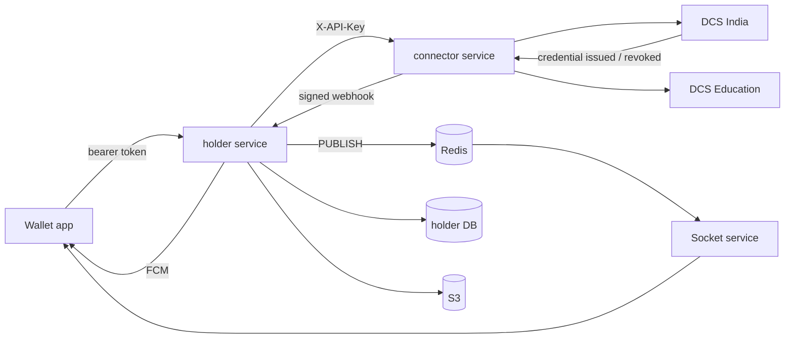
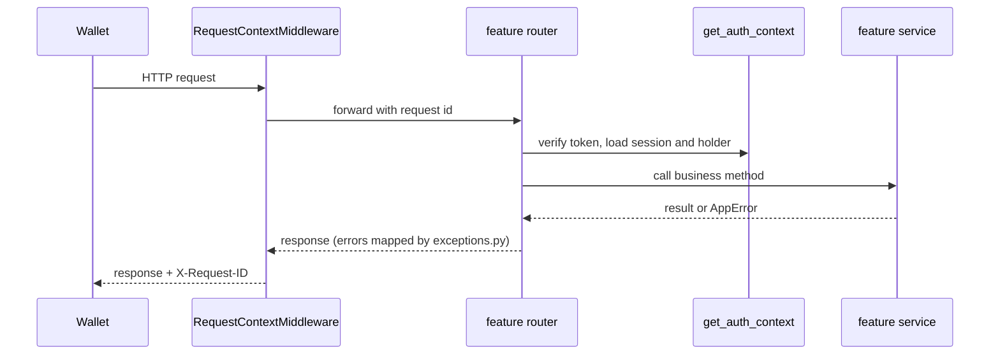

# Holder Service Documentation

> Last updated: 2026-10-21

## Where this service sits



The holder service owns holder identity: accounts, sessions, DIDs and
device keys, push tokens, inbox, audit trail, and stored presentations.
Credentials and requests stay in the DCS that issued them and are read
through the connector; nothing about them is stored here.

## Layout

```
app/
├── main.py              # create_app(), lifespan, middleware, routers
├── worker.py            # Background worker: socket and push delivery
├── api/
│   ├── router.py        # api_v1_router: mounts feature routers under /v1
│   └── openapi.py       # OpenAPI description, tags, ReDoc groups
├── core/
│   ├── config.py        # Settings, get_settings()
│   ├── context.py       # Request id context variable
│   ├── logging.py       # JSON / text logging with request id
│   ├── middleware.py    # RequestContextMiddleware
│   ├── exceptions.py    # AppError hierarchy and handlers
│   ├── database.py      # Async engine, sessions, ORM Base, DbSession
│   ├── models.py        # UTCDateTime, UUID and timestamp mixins
│   ├── db_check.py      # Pre-migration database check
│   ├── http_client.py   # Shared httpx client
│   ├── security.py      # Passwords, OTP/reset hashes, JWTs
│   ├── signatures.py    # X-EveryCRED-Signature verification
│   ├── storage.py       # S3 / local object storage
│   ├── email.py         # SMTP / console email
│   └── connector.py     # ConnectorClient and its response models
├── shared/
│   ├── schemas.py       # ErrorResponse, Page[ItemT]
│   ├── pagination.py    # Pagination query model
│   ├── uploads.py       # Size-limited reads, image type detection
│   └── identifiers.py   # Safe path params for DCS ids
└── features/
    ├── health/          # Liveness and readiness probes
    ├── auth/            # OTP, register, login, sessions, passwords
    ├── holders/         # holders table, profile, profile image
    ├── dids/            # DID provisioning, device keys, DID documents
    ├── devices/         # FCM push tokens
    ├── notifications/   # Inbox, connector events, outbox delivery
    ├── credentials/     # Credentials via the connector
    ├── gateway/         # Requests, workflow, KYC, DigiLocker via connector
    ├── wallet_storage/  # Presentation uploads
    └── audit/           # Holder audit trail
migrations/              # Alembic (env.py reads DATABASE_URL from settings)
```

## Request lifecycle



## Core modules

[config](core/config.md) · [context](core/context.md) ·
[logging](core/logging.md) · [middleware](core/middleware.md) ·
[exceptions](core/exceptions.md) · [database](core/database.md) ·
[models](core/models.md) · [db_check](core/db_check.md) ·
[http_client](core/http_client.md) · [security](core/security.md) ·
[signatures](core/signatures.md) · [storage](core/storage.md) ·
[email](core/email.md) · [connector](core/connector.md)

## Features

[health](features/health.md) · [auth](features/auth.md) ·
[holders](features/holders.md) · [dids](features/dids.md) ·
[devices](features/devices.md) ·
[notifications](features/notifications.md) ·
[credentials](features/credentials.md) · [gateway](features/gateway.md) ·
[wallet_storage](features/wallet_storage.md) · [audit](features/audit.md)

## Adding a feature

1. Create `app/features/<name>/` with `router.py`, `schemas.py`,
   `service.py`, `repository.py`, `models.py`, `dependencies.py`, and
   `exceptions.py` as needed.
2. Protect holder routes with `CurrentHolder` or `CurrentAuth` from
   `app/features/auth/dependencies.py`.
3. Mount the router in `app/api/router.py`.
4. Import new models in `migrations/env.py` and `tests/conftest.py`,
   then `uv run alembic revision --autogenerate -m "<change>"`.
5. Add `docs/features/<name>.md` and tests under
   `tests/features/<name>/`.
