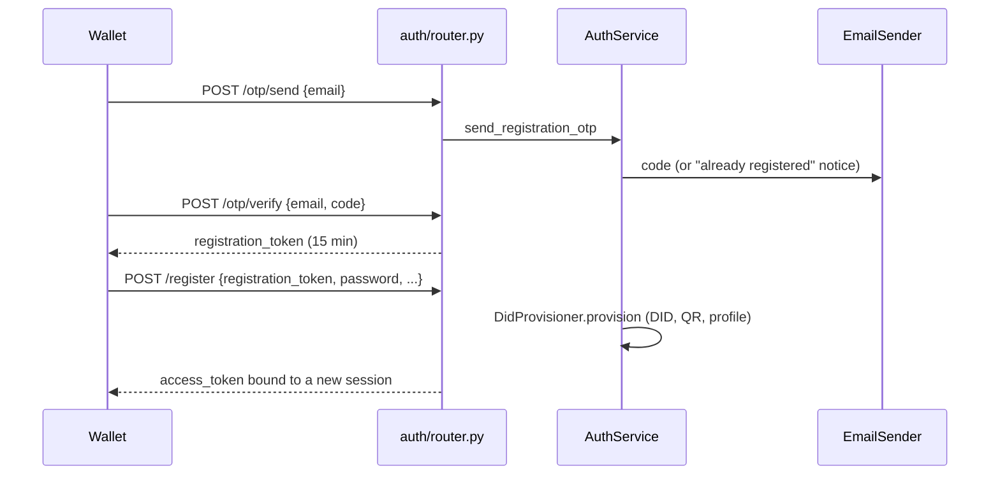

# Auth

> Package: `app/features/auth/`
> Owner: EveryCRED backend team
> Last updated: 2026-10-21

## Overview

Holder registration with an emailed OTP, sign-in with email or DID and
password, sign-out, and password change and reset. It also provides
`CurrentHolder` / `CurrentAuth`, the dependencies every other holder
route uses.

## Endpoints

| Method | Path | Summary | Auth |
|--------|------|---------|------|
| POST | `/v1/auth/otp/send` | Email a registration code | none |
| POST | `/v1/auth/otp/verify` | Exchange the code for a registration token | none |
| POST | `/v1/auth/register` | Create the account, DID, and first session | registration token |
| POST | `/v1/auth/login` | Open a session | none |
| POST | `/v1/auth/logout` | End the current session | bearer |
| POST | `/v1/auth/password/change` | Change password; sign out other sessions | bearer |
| POST | `/v1/auth/password/forgot` | Email a reset link | none |
| POST | `/v1/auth/password/reset` | Set a new password with the link's token | reset token |

### `POST /v1/auth/register`

Request:

```json
{
  "registration_token": "<from /otp/verify>",
  "password": "<at least 8 characters>",
  "full_name": "Example Holder",
  "mobile": "+910000000000"
}
```

Response `201 Created` (same shape as login):

```json
{
  "access_token": "<jwt>",
  "token_type": "bearer",
  "expires_at": "2026-11-20T10:00:00Z",
  "holder_id": "00000000-0000-0000-0000-000000000000",
  "did": "did:evrc:holder:00000000-0000-0000-0000-000000000000"
}
```

Errors:

| Status | `error.code` | When |
|--------|--------------|------|
| 400 | `invalid_otp` | Wrong, used, expired, or out-of-attempts code |
| 401 | `authentication_failed` | Invalid or expired registration token |
| 401 | `invalid_credentials` | Any failed login (unknown, wrong password, locked, inactive) |
| 400 | `invalid_current_password` | Password change with a wrong current password |
| 400 | `invalid_reset_token` | Unknown, used, or expired reset token |
| 409 | `email_already_registered` | Registering an email that has an account |
| 429 | `too_many_requests` | OTP requested again within the cooldown |

## Flow



Every authenticated request runs `get_auth_context`: verify the token,
load the session from `sid`, reject it if ended or expired, and load the
holder.

## Data model

Migration `migrations/versions/*_create_holder_service_tables.py`.

| Table | Purpose |
|-------|---------|
| `holder_sessions` | One row per signed-in device; `ended_at` revokes its token |
| `email_otps` | HMAC of each code, attempts, expiry, consumption |
| `password_reset_tokens` | HMAC of each reset token, expiry, consumption |

Account lockout state (`failed_login_count`, `locked_until`) lives on
`holders`.

## Configuration

| Env var | Default | Purpose |
|---------|---------|---------|
| `SESSION_LIFETIME_DAYS` | `30` | Session and access token lifetime |
| `REGISTRATION_TOKEN_MINUTES` | `15` | Time to finish registering after OTP |
| `OTP_TTL_MINUTES` | `10` | Code lifetime |
| `OTP_MAX_ATTEMPTS` | `5` | Wrong guesses per code |
| `OTP_RESEND_COOLDOWN_SECONDS` | `60` | Minimum gap between codes per email |
| `LOGIN_MAX_FAILED_ATTEMPTS` | `5` | Failures before lockout |
| `LOGIN_LOCKOUT_MINUTES` | `15` | Lockout length |
| `PASSWORD_RESET_TTL_MINUTES` | `30` | Reset link lifetime |
| `PASSWORD_RESET_URL` | `everycredwallet://reset-password?token={token}` | Link sent by email |

## Design decisions

- **Sessions instead of a token blacklist.** The token carries `sid`;
  ending the session row revokes it, with one indexed primary-key read
  per request and no Redis.
- **No account enumeration.** OTP send, forgot password, and login give
  the same response whether or not the email is registered. A registered
  email gets a notice instead of a code. Unknown-account logins spend
  the time of a real password check.
- **Locked accounts still verify the password** so timing does not
  reveal the lock; the error is the same `invalid_credentials`.
- **Password change ends other sessions; reset ends all of them**, and
  both deactivate those sessions' push tokens.
- **Emails are lower-cased** because the email links the holder to DCS
  records.

## Known limitations

- No refresh tokens; the wallet signs in again after
  `SESSION_LIFETIME_DAYS`.
- No social sign-in (Google, LinkedIn, Office 365) yet; DCS
  `holder_wallet_app` has it.
- No mobile OTP (Kaleyra) yet.
- Per-IP rate limiting is left to nginx or the API gateway.

## Testing

- `tests/features/auth/test_auth.py`

```bash
curl -X POST http://127.0.0.1:8040/v1/auth/login \
  -H "Content-Type: application/json" \
  -d '{"identifier": "holder@example.com", "password": "<password>"}'
```
