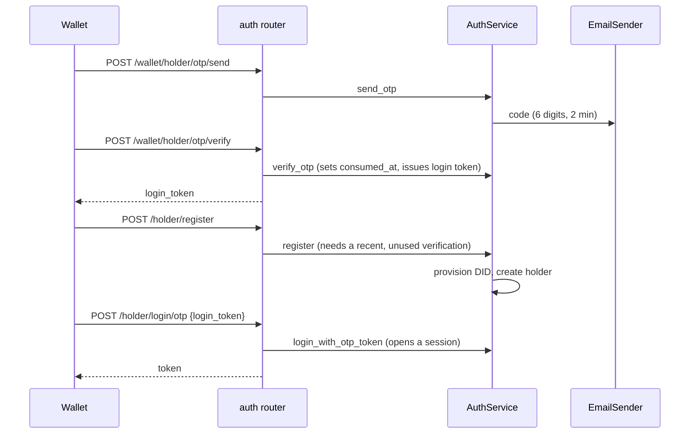

# Holder account (auth)

> Package: `app/features/auth/`
> Last updated: 2026-10-28

## Overview

Registration, sign-in, sessions, password change and reset, and account
deletion and recovery for wallet holders. The routes keep the DCS
backend's paths, bodies, status codes and messages so the wallet app
works unchanged; see [wallet_compatibility.md](../wallet_compatibility.md).

## Endpoints

| Method | Path | Summary | Auth |
|--------|------|---------|------|
| POST | `/v1/holder/validate` | Check a holder exists by email or DID | none |
| POST | `/v1/holder/login` | Sign in, or get a recovery token | none |
| POST | `/v1/holder/recover` | Restore a recently deleted account | recovery token |
| POST | `/v1/holder/register` | Create the account and DID | verified OTP |
| POST | `/v1/wallet/holder/otp/send` | Email a 6-digit code | none |
| POST | `/v1/wallet/holder/otp/verify` | Check the code | none |
| POST | `/v1/holder/forget` | Email a reset link | none |
| POST | `/v1/holder/reset/{token}/submit` | Set a new password (form) | reset link |
| POST | `/v1/holder/password/change` | Change password | bearer |
| DELETE | `/v1/holder` | Delete my account | bearer |
| POST | `/v1/holder/logout` | End this device's session and its push tokens | bearer |
| POST | `/v1/holder/login/otp` | Sign in right after registering | OTP login token |
| POST | `/v1/holder/login/sso?token=&sso_type=gmail` | Sign in an existing account with a Google ID token | Google ID token |
| POST | `/v1/holder/email/confirmation` | Email a verification link (always 200) | none |
| PUT | `/v1/holder/email/verify?verify_token=` | Accept a verification link | link token |

Google sign-in (`app/features/auth/google.py`, `GoogleIdTokenVerifier`)
fetches Google's certificates with the shared HTTP client, then checks
the signature, an audience in `GOOGLE_CLIENT_IDS`, the issuer, expiry,
and `email_verified`. The account is the one with the token's email;
the request body is ignored. Only `gmail` is accepted: the DCS
`office365` flow trusted an email from the body, and `linkedin` needs a
web redirect. Sign-in never creates an account.

### `POST /v1/holder/login`

Request:

```json
{ "email": "holder@example.com", "password": "<password>" }
```

`did` may be sent instead of `email`. Response `200`:

```json
{
  "status": "success",
  "data": { "user_type": "holder", "token": "<access token>", "is_deleted": false },
  "message": "logged in successfully"
}
```

For an account deleted within `ACCOUNT_DELETION_GRACE_DAYS`, `data` is
`{"is_deleted": true, "token": "<recovery token>"}`; send that token to
`/v1/holder/recover`.

Errors:

| Status | `message` | When |
|--------|-----------|------|
| 400 | Email or DID required | Neither identifier sent |
| 400 | Email or Password is invalid | Wrong password or inactive account |
| 404 | Email or Password is invalid | No holder with that email or DID |
| 403 | This account is no longer recoverable… | Deleted past the grace period |
| 429 | Too many failed sign-in attempts… | Locked after repeated failures |

### `POST /v1/wallet/holder/otp/verify`

Request `{"email", "otp_code", "otp_type": "email"}`. Response `200`
`{"verified": true, "otp_uuid": "<uuid>", "login_token": "<token>"}`
"OTP verified successfully". `login_token` is for
`/v1/holder/login/otp`; only its HMAC is stored.

| Status | `message` | `data` |
|--------|-----------|--------|
| 400 | Invalid OTP or OTP not found | null |
| 400 | OTP already verified | null |
| 400 | OTP has expired | null |
| 400 | Invalid OTP. N attempt(s) remaining | `{remaining_attempts, max_attempts}` |
| 400 | Maximum attempts reached. Please try again with new OTP. | `{remaining_attempts: 0, max_attempts}` |

### `POST /v1/holder/register`

Request `{"name", "email", "password", "confirm_password", "contact"?}`.
Passwords match `^[A-Za-z\d!@#$%^&*]{8,}$`. Response `201` with
`data: null` and "Holder created successfully!". 400 for mismatched
passwords, an existing account ("Account already exists!"), or an email
not verified in the last `REGISTRATION_TOKEN_MINUTES`.

In the same transaction, issuer invites waiting for the email move to
the inbox and a report of the new account is queued for every linked
DCS (`OnboardingService.claim_invites`, see
[onboarding](onboarding.md)).

### `POST /v1/holder/login/otp`

Signs the holder in after registration without asking for the password
again. Request:

```json
{ "login_token": "<login_token from otp/verify>" }
```

Response `200`, the same as `/v1/holder/login`:

```json
{
  "status": "success",
  "data": { "user_type": "holder", "token": "<access token>", "is_deleted": false },
  "message": "logged in successfully"
}
```

The token works once, only after `/v1/holder/register` has used the
verification that issued it, and only within
`REGISTRATION_TOKEN_MINUTES` of that verification.

| Status | `message` | When |
|--------|-----------|------|
| 400 | Please complete registration before signing in. | The email is verified but not registered yet; the token stays usable |
| 400 | Automatic sign-in is no longer available. Please log in with your password. | Unknown, used or expired token, or the account cannot sign in |

Errors are 400, not 401, because the app signs the holder out after a
second 401.

### `POST /v1/holder/reset/{token}/submit`

Form fields `new_password`, `confirm_password`. 200 "Password reset
successfully". A bad link answers 400 with `data.state` set to
`expired`, `superseded` (used, or a newer link was sent), or `invalid`.

## Flow



Every authenticated request runs `get_auth_context`: verify the token,
load the session from `sid`, reject it if ended or expired, and reject
an inactive or deleted holder.

## Data model

Migrations `*_create_holder_service_tables.py`,
`*_wallet_compatible_ids_and_account_.py` and `*_otp_login_token.py`.

| Table / column | Purpose |
|----------------|---------|
| `holder_sessions` | One row per signed-in device; `ended_at` revokes its token |
| `email_otps` | HMAC of each code, attempts, expiry; `consumed_at` = verified, `used_at` = used by a registration, `login_token_hash` / `signed_in_at` = the post-registration sign-in token and its use |
| `password_reset_tokens` | HMAC of each reset token, expiry, consumption |
| `holders.deleted_at` | Soft deletion; recovery possible during the grace period |

## Configuration

| Env var | Default | Purpose |
|---------|---------|---------|
| `SESSION_LIFETIME_DAYS` | `30` | Session and access token lifetime |
| `REGISTRATION_TOKEN_MINUTES` | `15` | Time to register, and to use the OTP login token, after OTP verification |
| `OTP_TTL_MINUTES` | `2` | Code lifetime (DCS default) |
| `OTP_MAX_ATTEMPTS` | `3` | Wrong guesses per code (DCS default) |
| `OTP_RESEND_COOLDOWN_SECONDS` | `60` | Minimum gap between codes per email |
| `LOGIN_MAX_FAILED_ATTEMPTS` | `5` | Failures before lockout |
| `LOGIN_LOCKOUT_MINUTES` | `15` | Lockout length |
| `PASSWORD_RESET_TTL_MINUTES` | `15` | Reset link lifetime |
| `PASSWORD_RESET_URL` | `everycredwallet://reset-password?token={token}` | Link sent by email |
| `ACCOUNT_DELETION_GRACE_DAYS` | `30` | Recovery window after deletion |
| `RECOVERY_TOKEN_TTL_SECONDS` | `120` | Recovery token lifetime |

## Design decisions

- **Sessions instead of a token blacklist.** The token carries `sid`;
  ending the session row revokes it.
- **Register needs a server-side OTP check.** The DCS trusted the app
  to verify first; here `register` requires a verification of that
  email in the last `REGISTRATION_TOKEN_MINUTES` and marks it used, so
  one verification creates one account. The app's call order is
  unchanged.
- **The OTP login token is opaque and stored hashed.** It is a random
  256-bit value, not a JWT, so it can never be used as an access token.
  It is bound to the verification row, works only after that
  verification registered an account, and is claimed with a
  conditional update so concurrent requests cannot both sign in.
- **Recovery tokens are not JWTs.** They are a base64url payload plus an
  HMAC with `TOKEN_HASH_SECRET` and a type label, so they can never be
  used as access tokens.
- **Deleting is soft.** The row stays for the grace period; registering
  the same email afterwards replaces it.
- **DCS messages are kept**, including where they reveal whether an
  email is registered (OTP send, login 404), because the app depends on
  them. Forget password still answers the same for every email.

## Known limitations

- No refresh tokens; the wallet signs in again after
  `SESSION_LIFETIME_DAYS`.
- No social sign-in (Google, LinkedIn, Office 365) or mobile OTP.
- Per-IP rate limiting is left to nginx or the API gateway.

## Testing

- `tests/features/auth/test_auth.py`

```bash
curl -X POST http://127.0.0.1:8040/v1/holder/login \
  -H "Content-Type: application/json" \
  -d '{"email": "holder@example.com", "password": "<password>"}'
```
