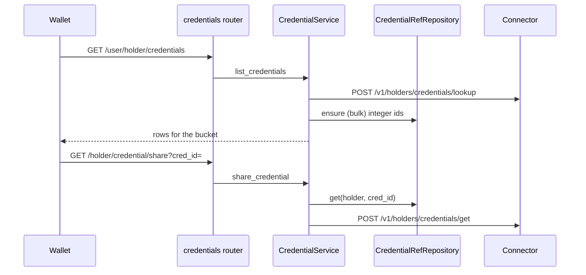

# Credentials

> Package: `app/features/credentials/`
> Last updated: 2026-10-30

## Overview

The credential endpoints the wallet app calls, in the DCS shapes. The
data comes live from the issuing DCS through the connector; this
service stores only integer references (`credential_refs`), never
credential content.

## Endpoints

| Method | Path | Summary | Auth |
|--------|------|---------|------|
| GET | `/v1/user/holder/credentials` | List one bucket of my credentials | bearer |
| GET | `/v1/holder/credential/share?cred_id=` | Share payload | bearer |
| GET | `/v1/holder/credential/preview?cred_id=` | Fields, validity and revocation (DCS preview shape; every `ftype` is `text`) | bearer |
| GET | `/v1/holder/credential/download?cred_id=` | `{credential: <document URL>}` | bearer |
| POST | `/v1/holder/send/email?cred_id=` | Email the verifier link to up to `MAX_SHARE_RECIPIENTS` addresses | bearer |
| GET | `/v1/holder/stats?cred_id&page&per_page` | Verification statistics | bearer |
| GET | `/v1/holder/credential/notification?page&per_page` | Issue and revoke notifications | bearer |
| GET | `/v1/user/credential/{credential_unique_id}` | Public lookup (verifier) | none |
| POST | `/v1/credential/verification/analytics?uuid=` | Record a verification | none |

### `GET /v1/user/holder/credentials`

Query: `holder_id` (must be the caller's profile `id`), `type`
(`issued` | `revoked` | `expired`), `page` (default 1), `per_page`
(0–100, default 0 = plain list of every row).

Response `200` "Credentials are fetched successfully":

```json
{
  "data": [
    {
      "id": 2718281828459045,
      "uuid": "<connector credential id>",
      "source_code": "dcs-india",
      "credential_unique_id": "00000000-0000-0000-0000-000000000000",
      "credential_path": "https://cdn.example.com/credential.json",
      "subject_name": "Computer Science",
      "candidate_name": "Test Holder",
      "issuer_name": "Example University",
      "logo": "https://cdn.example.com/subject.png",
      "issuer_logo": "https://cdn.example.com/issuer.png",
      "valid_from": "2026-10-01T00:00:00Z",
      "valid_until": null,
      "revoked": false,
      "revoked_at": null,
      "is_issued": true,
      "created_at": "2026-10-01T00:00:00"
    }
  ],
  "pages": 1,
  "total": 1
}
```

Errors:

| Status | `message` | `data` |
|--------|-----------|--------|
| 403 | You can only view your own credentials. | null |
| 404 | Details not found! | `{"data": [], "pages": <page>, "total": 0}` (empty bucket; the app shows an empty list) |

### Other endpoints

- **Share** returns `{name, viewer_link, qr_image, is_verifiable,
  download_link, logo_image, subject_name}`; `viewer_link` is
  `VERIFIER_BASE_URL` + unique id, `""` when there is no QR code.
- **Stats** runs the connector operation `credentials.stats` on the
  credential's source and returns its status, message and `data`.
- **Notifications** return `{data, pages, total}`; each item has `type`,
  `credential_image`, `issued_at` or `revoked_at`, `credential`,
  `issuer_name`, `created_at`. Empty is 200.
- **Public lookup** returns the DCS verifier shape (`not_draft`,
  `credential_json_content` as the original string, `is_revoked`,
  `bn_credential`, issuer fields…); unknown is 404 "Credential does not
  found from the given id!".
- **Analytics** forwards `{verification_status, stage?, reason?,
  checkpoint_id?}` and answers 201 "Information stored successfully".

## Flow



## Data model

`credential_refs`: `numeric_id` (random integer below 2^52, unique),
`holder_id`, `source_code`, `credential_id`; unique per holder and
pair. References only.

`CredentialRefRepository.ensure` creates missing references in a
savepoint. The wallet loads the issued, expired and revoked lists in
parallel, so on a holder's first load several requests try to create the
same rows. The losers hit the unique key, re-read with
`SELECT ... FOR UPDATE` (a plain read would still return their
REPEATABLE READ snapshot) and reuse the winner's ids, so every list
returns the same `id` for a credential.

## Configuration

| Env var | Default | Purpose |
|---------|---------|---------|
| `VERIFIER_BASE_URL` | `https://verifier.example.com/` | Prefix of `viewer_link` |

## Design decisions

- **Integer ids per holder.** Several DCS sources can reuse an integer
  `credential.id`, so the service hands out its own. Resolving `cred_id`
  through the signed-in holder's references makes another holder's id
  a 404.
- **`credential_path` is absolute**, so the app downloads the document
  from the issuing DCS without a fixed asset host.
- **The raw credential document is passed through unchanged** in the
  public lookup so proofs can be checked against the original bytes.

## Known limitations

- Stats paging is not forwarded by the connector yet.
- Issue and revoke times come from the connector's routing table.

## Testing

- `tests/features/credentials/test_credentials.py` (fake connector)
