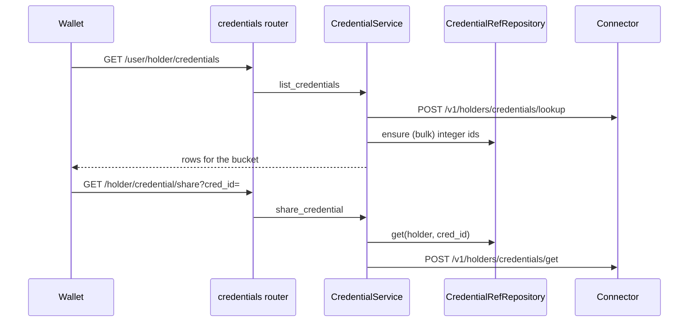

# Credentials

> Package: `app/features/credentials/`
> Last updated: 2026-10-30

## Overview

The credential endpoints the wallet app calls, in the DCS shapes. The
data comes live from the issuing DCS through the connector; this
service stores only integer references (`credential_refs`), never
credential content.

## Endpoints

| Method | Path | Summary | Auth |
|--------|------|---------|------|
| GET | `/v1/user/holder/credentials` | List one bucket of my credentials | bearer |
| GET | `/v1/holder/credential/share?cred_id=` | Share payload | bearer |
| GET | `/v1/holder/credential/preview?cred_id=` | Fields, validity and revocation (DCS preview shape; every `ftype` is `text`) | bearer |
| GET | `/v1/holder/credential/download?cred_id=` | `{credential: <document URL>}` | bearer |
| GET | `/v1/holder/credential/linked?cred_id=` | My credentials in the same linked chain, with names and status | bearer |
| POST | `/v1/holder/send/email?cred_id=` | Email the verifier link to up to `MAX_SHARE_RECIPIENTS` addresses | bearer |
| GET | `/v1/holder/stats?cred_id&page&per_page` | Verification statistics | bearer |
| GET | `/v1/holder/credential/notification?page&per_page&include_requests` | Credential issue / revoke notifications, plus request notifications when asked | bearer |
| GET | `/v1/user/credential/{credential_unique_id}` | Public lookup (verifier) | none |
| POST | `/v1/credential/verification/analytics?uuid=` | Record a verification | none |

### `GET /v1/user/holder/credentials`

Query: `holder_id` (must be the caller's profile `id`), `type`
(`issued` | `revoked` | `expired`), `page` (default 1), `per_page`
(0–100, default 0 = plain list of every row).

Response `200` "Credentials are fetched successfully":

```json
{
  "data": [
    {
      "id": 2718281828459045,
      "uuid": "<connector credential id>",
      "source_code": "dcs-india",
      "credential_unique_id": "00000000-0000-0000-0000-000000000000",
      "credential_path": "https://cdn.example.com/credential.json",
      "subject_name": "Computer Science",
      "candidate_name": "Test Holder",
      "issuer_name": "Example University",
      "logo": "https://cdn.example.com/subject.png",
      "issuer_logo": "https://cdn.example.com/issuer.png",
      "valid_from": "2026-10-01T00:00:00Z",
      "valid_until": null,
      "revoked": false,
      "revoked_at": null,
      "is_issued": true,
      "created_at": "2026-10-01T00:00:00"
    }
  ],
  "pages": 1,
  "total": 1
}
```

Errors:

| Status | `message` | `data` |
|--------|-----------|--------|
| 403 | You can only view your own credentials. | null |
| 404 | Details not found! | `{"data": [], "pages": <page>, "total": 0}` (empty bucket; the app shows an empty list) |

### `GET /v1/holder/credential/notification`

The wallet's notification list, newest first. `data` is
`{"data": [...], "pages", "total"}`.

- Every credential gives an `"type": "issued"` item, and a revoked one
  also a `"type": "revoked"` item, built from the connector lookup. They
  keep the DCS keys (`credential`, `issuer_name`, `credential_image`,
  `issued_at` / `revoked_at`, `created_at`) and add a ready-to-show
  `title` and `message`, e.g. "Example University has issued you
  Computer Science.".
- With `include_requests=true`, the holder's credential request
  notifications are merged in as `"type": "request"` items: `title`,
  `message`, `notification_type` (`new_credential_request`,
  `credential_request_approved`, `credential_request_declined`,
  `credential_request_updated`), `request_id` (opens
  `everycredwallet://request/<request_id>`) and `created_at`. They come
  from the inbox rows the connector's `request.created` /
  `request.updated` events create (see [notifications](notifications.md)).
  Only the newest `page * per_page` request rows are read, and `total`
  counts both kinds.

`include_requests` is off by default because older app versions print
every item as "issuer has issued you credential".

### `GET /v1/holder/credential/linked`

The wallet's credential page shows a linked credential's chain. The
public linked list it reads carries no credential names and nothing
about the holder's own copies, so this route returns the caller's own
credentials of the same chain.

```json
{
  "status": "success",
  "message": "Linked credentials fetched successfully!",
  "data": {
    "chain_id": "00000000-0000-0000-0000-000000000001",
    "credentials": [
      {
        "id": 4815162342,
        "credential_id": "00000000-0000-0000-0000-000000000001",
        "previous_credential_ids": [],
        "subject_name": "Employment Verification",
        "issuer_name": "Example Employer",
        "issued_at": "2026-11-05T10:00:00",
        "revoked": false,
        "revoked_at": null,
        "valid_until": null,
        "is_current": false
      }
    ]
  }
}
```

- The chain id is the single key of the credential document's signed
  `linkedCredentialData.firstCredentialLinkedList`, without `urn:uuid:`
  and lower-cased (`app/features/credentials/linked.py`). An SD-JWT
  credential is read from its JWT payload.
- `credential_id` is the document's own `id` (else `jti`), normalised the
  same way: the id the public linked list uses, so the wallet can match
  each row to a list entry. `id` is the holder's integer reference.
- `previous_credential_ids` are the credentials this one directly
  follows, read from the signed block's `previousCredentialsId` and
  `previousOwnershipCredentialId` maps (normalised, duplicates dropped).
  The wallet uses them to show each credential's "Next" credentials,
  including ones not saved on the device. The links are signed before
  anchoring, so they are present even when the issuer's chain record
  failed.
- Only credentials the connector routes to the caller are listed, oldest
  first. Another holder's credentials in the chain (after an ownership
  transfer) are never returned.
- `revoked` / `revoked_at` follow the connector status, as in the list.
- A standalone credential answers 200 with `data: null` and "Credential
  is not linked.". An id that is not the caller's answers 404 "Details
  not found!".

### Other endpoints

- **Share** returns `{name, viewer_link, qr_image, is_verifiable,
  download_link, logo_image, subject_name}`; `viewer_link` is
  `VERIFIER_BASE_URL` + unique id, `""` when there is no QR code.
- **Stats** runs the connector operation `credentials.stats` on the
  credential's source and returns its status, message and `data`.
- **Notifications** return `{data, pages, total}`; each item has `type`,
  `credential_image`, `issued_at` or `revoked_at`, `credential`,
  `issuer_name`, `created_at`. Empty is 200.
- **Public lookup** returns the DCS verifier shape (`not_draft`,
  `credential_json_content` as the original string, `is_revoked`,
  `bn_credential`, issuer fields…); unknown is 404 "Credential does not
  found from the given id!".
- **Analytics** forwards `{verification_status, stage?, reason?,
  checkpoint_id?}` and answers 201 "Information stored successfully".

## Flow



## Data model

`credential_refs`: `numeric_id` (random integer below 2^52, unique),
`holder_id`, `source_code`, `credential_id`; unique per holder and
pair. References only.

`CredentialRefRepository.ensure` creates missing references in a
savepoint. The wallet loads the issued, expired and revoked lists in
parallel, so on a holder's first load several requests try to create the
same rows. The losers hit the unique key, re-read with
`SELECT ... FOR UPDATE` (a plain read would still return their
REPEATABLE READ snapshot) and reuse the winner's ids, so every list
returns the same `id` for a credential.

## Configuration

| Env var | Default | Purpose |
|---------|---------|---------|
| `VERIFIER_BASE_URL` | `https://verifier.example.com/` | Prefix of `viewer_link` |

## Design decisions

- **Integer ids per holder.** Several DCS sources can reuse an integer
  `credential.id`, so the service hands out its own. Resolving `cred_id`
  through the signed-in holder's references makes another holder's id
  a 404.
- **`credential_path` is absolute**, so the app downloads the document
  from the issuing DCS without a fixed asset host.
- **The raw credential document is passed through unchanged** in the
  public lookup so proofs can be checked against the original bytes.

## Known limitations

- Stats paging is not forwarded by the connector yet.
- Issue and revoke times come from the connector's routing table.

## Testing

- `tests/features/credentials/test_credentials.py` (fake connector)
- `tests/features/credentials/test_linked_credentials.py`: the linked
  route, chain grouping, SD-JWT payloads and damaged blocks
