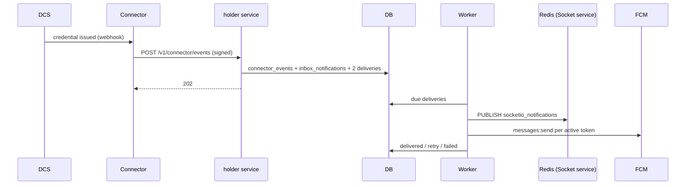

# Notifications

> Package: `app/features/notifications/`
> Owner: EveryCRED backend team
> Last updated: 2026-10-28

## Overview

When a DCS issues or revokes a credential, a credential request
changes, or an issuer invites a holder, the connector sends a signed
webhook here. The service writes
an inbox entry and delivers it live over the EveryCRED Socket service
and FCM push. The wallet also reads and marks its inbox.

## Endpoints

| Method | Path | Summary | Auth |
|--------|------|---------|------|
| GET | `/v1/notifications?limit&offset&unread_only` | List my inbox | bearer |
| POST | `/v1/notifications/{id}/read` | Mark one read | bearer |
| POST | `/v1/notifications/read-all` | Mark all read | bearer |
| POST | `/v1/connector/events` | Receive a connector event | HMAC signature |

### `POST /v1/connector/events`

Headers: `X-EveryCRED-Event`, `X-EveryCRED-Delivery` (idempotency key),
`X-EveryCRED-Signature: t=<unix>,v1=<hex HMAC-SHA256 of "<t>.<body>">`.

```json
{
  "id": "evt_0001",
  "event": "credential.issued",
  "created_at": "2026-10-21T10:00:00Z",
  "data": {
    "source_code": "dcs-india",
    "holder_email": "holder@example.com",
    "credential_id": "cred-1",
    "request_id": null,
    "status": "issued"
  }
}
```

Response `202 Accepted`: `{"status": "accepted" | "duplicate" | "ignored"}`.
`ignored` means no holder has that email. A `holder.invited` event for
an email without an account is kept for sign-up instead and answered
`accepted` (see [onboarding](onboarding.md)).

`holder.invited` carries `source_code`, `holder_email` and an optional
`inviter_name` (up to 200 characters); `credential_id` and `request_id`
are null.

Errors:

Errors use the DCS envelope `{"status", "data", "message"}`.

| Status | `message` | When |
|--------|-----------|------|
| 400 | A valid delivery id is required. / The event body is invalid. | Signed, but the delivery id or body is unusable |
| 401 | The signature is invalid. | Missing, wrong, or stale signature |
| 413 | The request body must not exceed … bytes. | Body over 16 KB |

## Flow



Event to notification type (values match the DCS holder registry):

| Event | `data.status` | `notification_type` | Redirect |
|-------|---------------|---------------------|----------|
| `credential.issued` | — | `credential_issued` | `credential/<credential_id>` |
| `credential.revoked` | — | `credential_revoked` | `credential/<credential_id>` |
| `request.created` | — | `new_credential_request` | `request/<request_id>` |
| `request.updated` | `approved` | `credential_request_approved` | `request/<request_id>` |
| `request.updated` | `declined` | `credential_request_declined` | `request/<request_id>` |
| `request.updated` | other | `credential_request_updated` | `request/<request_id>` |
| `holder.invited` | — | `issuer_invitation` | none |

The socket message is the shape DCS publishes, so the existing Socket
service needs no change:
`{"event": "new_request", "data": <inbox payload>, "user_uuid": "<holder id>", "room": "user_<holder id>"}`.

Retries: socket publish failures and retryable FCM errors (429, 5xx,
network) wait 30 s, 2 min, 10 min, 30 min, then hourly, up to
`NOTIFICATION_MAX_ATTEMPTS`. A channel that is not configured, or a
holder with no active device, marks the row `skipped`.

## Data model

| Table | Purpose |
|-------|---------|
| `inbox_notifications` | Inbox entries (DCS inbox payload fields) |
| `connector_events` | Received delivery ids (unique), event, source, holder id; no email |
| `notification_deliveries` | Outbox: channel, status, attempts, `next_attempt_at`, `last_error` |

## Configuration

| Env var | Default | Purpose |
|---------|---------|---------|
| `CONNECTOR_WEBHOOK_SECRET` | required | Verifies event signatures |
| `WEBHOOK_TOLERANCE_SECONDS` | `300` | Replay window |
| `SOCKET_REDIS_URL` | unset (socket off) | Redis of the Socket service, with DB index, e.g. `redis://:<password>@redis:6379/2` |
| `SOCKET_CHANNEL` | `socketio_notifications` | Channel the Socket service subscribes to |
| `SOCKET_EVENT` | `new_request` | Socket.IO event the wallet listens for |
| `FCM_PROJECT_ID`, `FCM_SERVICE_ACCOUNT_JSON` | unset (push off) | Firebase project and service account JSON |
| `NOTIFICATION_REDIRECT_BASE_URL` | `everycredwallet://` | Deep link base |
| `NOTIFICATION_MAX_ATTEMPTS` | `8` | Attempts per delivery |
| `WORKER_INTERVAL_SECONDS` | `5` | Worker loop interval |

## Design decisions

- **Deleted accounts get no notifications.** An event for a holder whose
  account is deleted is recorded and answered `ignored`.
- **Outbox, not inline sends.** The webhook answers in milliseconds and
  a Redis or FCM outage never loses a notification.
- **Signature before parsing.** Nothing unauthenticated is interpreted.
- **No email stored for events**; only the resolved holder id.
- **Generic texts.** Events carry ids only; the wallet loads details.
  An invite names the inviting organisation, since there is nothing
  else to open.

## Known limitations

- The Socket service lets any client join any `user_<id>` room without
  authentication (DCS `Socket/asgi.py`). Holder ids are random UUIDs,
  but the Socket service should verify a holder token before joining.
- One worker instance only; deliveries are not locked across processes.

## Testing

`tests/features/notifications/test_connector_events.py` and
`tests/features/notifications/test_delivery.py`.
