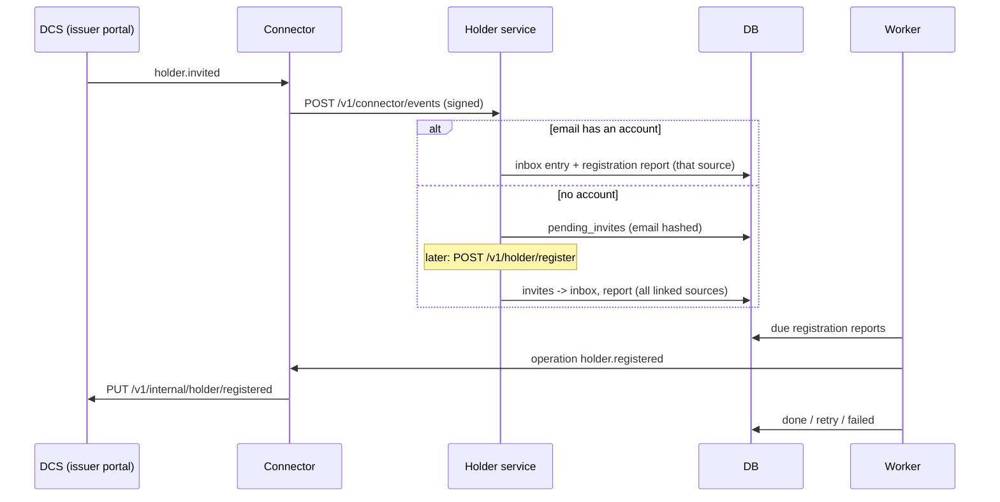

# Onboarding

> Package: `app/features/onboarding/`, worker: `app/worker.py`
> Owner: EveryCRED backend team
> Last updated: 2026-10-30

## Overview

Issuers invite holders by email from the issuer portal of a DCS. This
feature puts those invites in the holder's wallet inbox, holds them for
emails that have no account yet, and tells each DCS when the holder has
signed up, so the issuer portal shows the holder as registered and stops
offering to resend the invite. It also sends each DCS the holder's own
name and contact number, at sign-up and whenever they change, so issuer
screens show the holder's current details.

It has no endpoints of its own. Invites arrive as the connector event
`holder.invited` on `POST /v1/connector/events` (see
[notifications](notifications.md)); registration is the existing
`POST /v1/holder/register` (see [auth](auth.md)).

## Flow

1. `ConnectorEventService.receive` (notifications) hands a
   `holder.invited` event to `OnboardingService`:
   - known holder: the invite becomes an inbox notification as any event
     does, and `queue_report(holder_id, source_code)` reports the existing
     account to that DCS only;
   - unknown email: `hold_invite` stores a `PendingInvite` and the event
     is answered `accepted`.
2. `AuthService.register` calls `claim_invites(holder)` in the same
   transaction as the new account. Every pending invite for the email
   becomes an inbox notification (`add_notifications`, one flush for all)
   and is deleted, and a registration report and a profile report, both
   with no `source_code`, are queued. `queue_report` always queues the
   pair, so an invite for an existing holder also sends that DCS the
   holder's profile.
3. `HolderProfileService.update_profile` calls `queue_profile_report`
   when the name or contact number actually changed, in the same
   transaction as the change. It queues nothing while an all-sources
   profile report is still pending, because that report reads the holder
   when it is sent and so carries this change too.
4. The worker runs `RegistrationReportService.deliver_due` after the
   notification deliveries in each round. It sends each report's
   `operation` (`source_code` from the report, or none for every linked
   source) and reads each source's answer:
   - `holder.registered`: no body;
   - `holder.profile_updated`: body `{"name": <full_name>, "mobile":
     <mobile or null>}`, read from the holder at send time.

The invite inbox entry:

| Field | Value |
|---|---|
| `notification_type` | `issuer_invitation` |
| `title` | `New Invitation` |
| `message` | `<inviter_name> invited you to receive credentials.` (`An issuer` when no name was sent) |
| `redirect_*` | none |
| `extra_metadata` | `{"source_code": "<source>"}` |

### Report outcomes

| Answer | Result |
|---|---|
| Every source answers 2xx, or 404 (the DCS has no holder for the email) | `done` |
| Any source answers 5xx (502 when the connector could not reach it), 401, 403 or 429 | Retry; the whole operation is sent again |
| Connector unreachable or answers 5xx | Retry |
| Connector answers 404 or 400/422 (source gone or not linked) | `failed` |

Retries wait 30 s, 2 min, 10 min, 30 min, then hourly, up to
`NOTIFICATION_MAX_ATTEMPTS`, then the report is `failed`. Sending the
operation again to a source that already applied it is safe: the DCS
change is idempotent.

## Data model

Migrations `7c1d4e9b2a60_holder_onboarding` and
`950da251c6f9_report_operation` (adds `operation`; existing rows become
`holder.registered`).

| Table | Purpose |
|---|---|
| `pending_invites` | `email_key` (HMAC-SHA256 of the lower-cased email with `TOKEN_HASH_SECRET`, indexed), `source_code`, `inviter_name` |
| `registration_reports` | Outbox: `holder_id`, `source_code` (null = every linked source), `operation` (`holder.registered` or `holder.profile_updated`), `status` (`pending`, `done`, `failed`), `attempts`, `next_attempt_at`, `last_error` |

## Configuration

No new settings. It uses `TOKEN_HASH_SECRET` (email keys),
`NOTIFICATION_MAX_ATTEMPTS` and `WORKER_INTERVAL_SECONDS` (reports), and
the connector settings (`CONNECTOR_BASE_URL`, `CONNECTOR_API_KEY`,
`CONNECTOR_TIMEOUT_SECONDS`).

## Design decisions

- **Hashed email for pending invites.** The table matches an email at
  sign-up without keeping addresses of people who never registered.
  Changing `TOKEN_HASH_SECRET` orphans the invites waiting at that time.
- **Report every linked source, not only inviters.** A DCS that only
  issued credentials to the email keeps a `provisioned` holder row; it
  moves to `registered` too.
- **Outbox, not a call during registration.** Registration never waits
  on, or fails because of, the connector or a DCS.
- **Profile read at send time.** A profile report carries no values of
  its own, so a retry or a delayed report never sends an outdated name,
  and several quick edits collapse into one report.
- **Name and contact only.** The profile image and the DID are not sent:
  the image is stored in this service's storage, and a DCS issues
  credentials to the DID it already holds.

## Known limitations

- Pending invites for emails that never register are kept indefinitely.
- Holders who registered before this feature are reported to a DCS only
  when it invites them again.
- An invite sent before account deletion is not restored on account
  recovery.
- One worker instance only; reports are not locked across processes.

## Testing

`tests/features/onboarding/test_onboarding.py`: invite held until
registration, invite for an existing holder, report sent as the
`holder.registered` operation, profile report sent with the current
name and contact, one pending profile report per holder, no report for
an unchanged profile, retry on an unavailable source or connector,
failure for an unlinked source.
