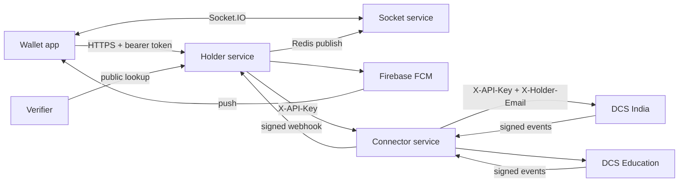
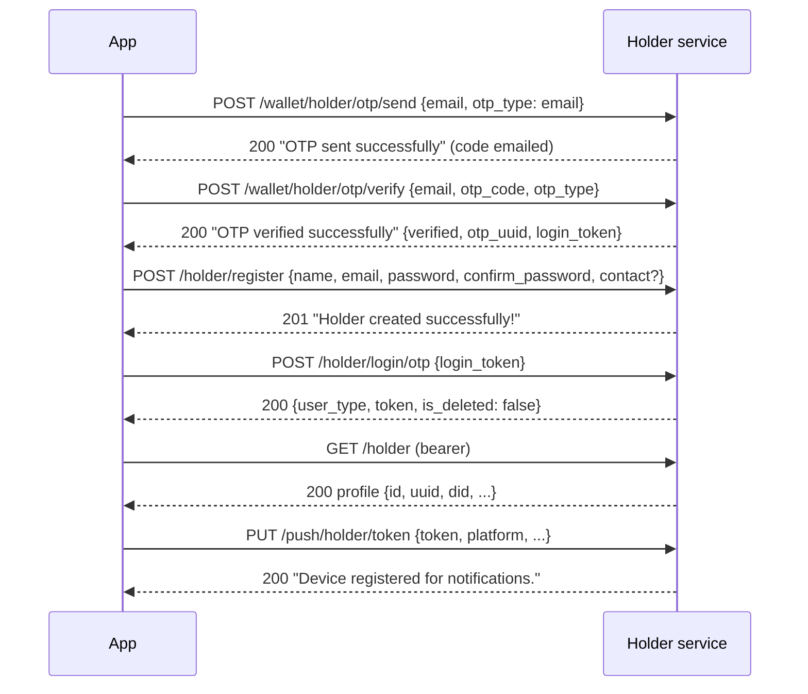
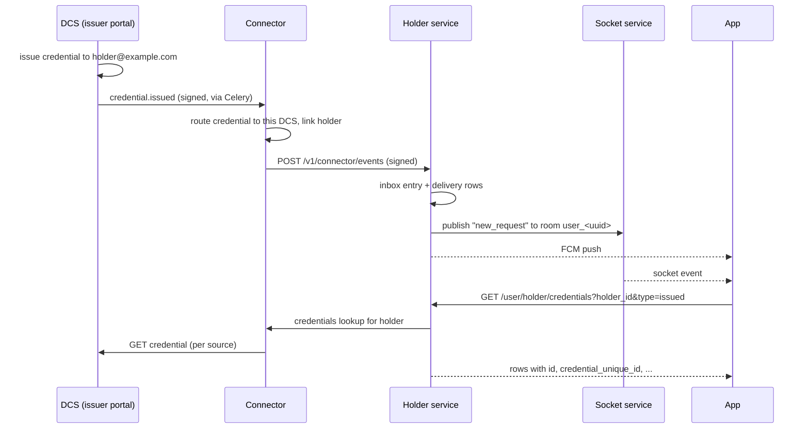
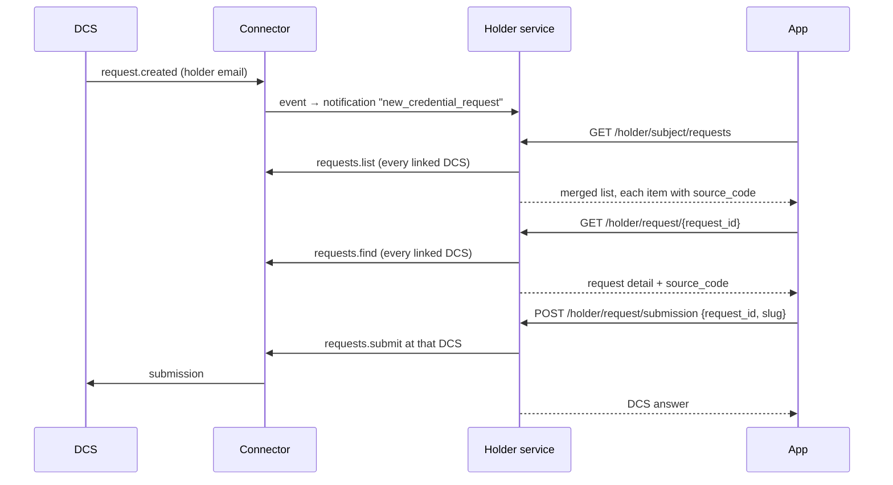
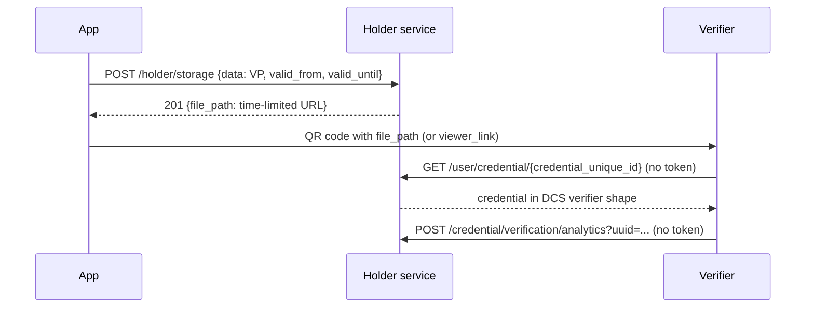

# Holder wallet app integration guide

> Last updated: 2026-10-28

How the EveryCRED holder wallet app talks to the platform once it uses
the holder service instead of the DCS backend: what to call, in which
order, and what comes back, for every flow from sign-up to sharing a
credential.

Audience: wallet app developers. Per-endpoint detail lives in
[`wallet_compatibility.md`](wallet_compatibility.md) and
[`features/`](features/); this guide ties them together.

## 1. Architecture



| Component | Owns | The app talks to it? |
|---|---|---|
| Holder service | Holder accounts, sessions, DIDs, device keys, push tokens, inbox, stored presentations | **Yes, for every API call** |
| Socket service | Live delivery of inbox events | Yes, Socket.IO connection (unchanged) |
| Connector service | Which DCS holds which credential and holder | No |
| DCS backends | Credentials, requests, workflows, KYC, DigiLocker data | No, only through the holder service |

The holder service stores no credential or request content. Every
credential and request read is fetched live from the DCS that issued it,
so a DCS outage shows up as a 502 on those calls only.

## 2. Conventions

### Base URL

```
EXPO_PUBLIC_API_BASE_URL=https://<api-host>/holder/v1
```

All paths below are relative to `/v1` on that host, e.g.
`POST /v1/holder/login` is `https://<api-host>/holder/v1/holder/login`.

### Headers

```
Content-Type: application/json
Accept: application/json
Authorization: Bearer <token>        # every route marked "bearer"
```

### Response envelope

Every response uses the DCS envelope:

```json
{ "status": "success", "data": { }, "message": "logged in successfully" }
```

- Decide success from the **HTTP status code** (200, 201, 202 are
  success). `status` is `"success"` / `"fail"`, or the numeric code for
  framework errors (missing token, validation, unknown route).
- `message` is written for the user; show it as-is.
- Empty `data` (`{}`, `[]`, `0`) is sent as `null`.

### Tokens and sessions

- Login returns one access token. There is no refresh token: it is
  valid for the session (`SESSION_LIFETIME_DAYS`, 30 by default).
- Every call checks the session server-side. Logout, password change,
  password reset and account deletion end sessions, and their tokens
  stop working immediately.
- **401 means the token is dead.** Sign the user out on 401. The
  service never answers 401 for anything else (an invalid email
  verification link, for example, is 400).

### Ids the app uses

| Id | Where it comes from | Used in |
|---|---|---|
| `id` (holder, integer) | `GET /v1/holder` | `holder_id` on the credential list |
| `uuid` (holder) | `GET /v1/holder` | Socket.IO room `user_<uuid>` |
| `id` (credential row, integer) | Credential list rows | `cred_id` on share, preview, download, stats, send email |
| `credential_unique_id` | Credential list rows | Verifier links and public lookup |
| `request_id` | Request list items | Request detail and submission |
| `source_code` | Request list items, operation results | `/v1/sources/{source_code}/...` routes |

Integer ids are random and scoped to the signed-in holder: another
holder's `cred_id` answers 404.

## 3. Onboarding



1. **Send OTP**: `POST /v1/wallet/holder/otp/send`

   ```json
   { "email": "holder@example.com", "otp_type": "email" }
   ```

   400 "Email already exist" if the email is registered; 429 if a code
   was sent within `OTP_RESEND_COOLDOWN_SECONDS`.

2. **Verify OTP**: `POST /v1/wallet/holder/otp/verify`

   ```json
   { "email": "holder@example.com", "otp_code": "123456", "otp_type": "email" }
   ```

   A wrong code answers 400 "Invalid OTP. N attempt(s) remaining" with
   `data: {remaining_attempts, max_attempts}`. Codes expire after
   `OTP_TTL_MINUTES` (2). A correct code returns
   `data: {verified: true, otp_uuid, login_token}`; keep `login_token`
   in memory for step 4 (never persist it).

3. **Register**: `POST /v1/holder/register`

   ```json
   {
     "name": "Test Holder",
     "email": "holder@example.com",
     "password": "Example123!",
     "confirm_password": "Example123!",
     "contact": "9000000000"
   }
   ```

   The email must have been OTP-verified within
   `REGISTRATION_TOKEN_MINUTES` (15). The service creates the holder's
   DID. 201 with `data: null`.

4. **Sign in**: `POST /v1/holder/login/otp`

   ```json
   { "login_token": "<login_token from step 2>" }
   ```

   Returns the same `data` as `/v1/holder/login`. The token works once,
   within `REGISTRATION_TOKEN_MINUTES` (15) of verification. On 400,
   fall back to `/v1/holder/login` with the password.

5. **Profile**, **push token**: see sections 4 and 7.

The holder's email is the link to every DCS: credentials and requests
issued to that email appear in the wallet automatically, including ones
issued before the holder registered.

## 4. Signing in and the session

### Password login

`POST /v1/holder/login` with `{email, password}` or `{did, password}`.

| Status | `data` / `message` | Meaning |
|---|---|---|
| 200 | `{user_type: "holder", token, is_deleted: false}` | Signed in |
| 200 | `{is_deleted: true, token}` "This account was recently deleted. Would you like to recover it?" | Offer recovery; this token only works on `/holder/recover` |
| 400 | "Email or Password is invalid" | Wrong password or inactive account |
| 404 | "Email or Password is invalid" | No such holder |
| 403 | "This account is no longer recoverable…" | Deleted past the grace period |
| 429 | "Too many failed sign-in attempts…" | Locked for `LOGIN_LOCKOUT_MINUTES` |

**Recover**: `POST /v1/holder/recover {"recovery_token": "<token>"}`
within `RECOVERY_TOKEN_TTL_SECONDS` (120) → 200 `{user_type, token}`.

### Google sign-in

```
POST /v1/holder/login/sso?token=<Google ID token>&sso_type=gmail
Body: {}
```

- Send the **ID token** from Google Sign-In, not an access token. Its
  audience must be one of the server's `GOOGLE_CLIENT_IDS` (web,
  Android and iOS client ids).
- Signs in the **existing** account with the token's email. 404
  "Please register!" when there is none: run onboarding first.
- 200 `{token, role_type: "holder"}`.
- `linkedin` and `office365` are not supported (400 "Invalid token").
  The body is accepted for compatibility and ignored.

### Signing out and account management

| Action | Call | Effect |
|---|---|---|
| Sign out | `POST /v1/holder/logout` (bearer) | Ends this device's session; its push token stops. Other devices stay signed in |
| Change password | `POST /v1/holder/password/change {current_password, new_password, confirm_password}` | Every **other** session ends; returns the profile |
| Forgot password | `POST /v1/holder/forget {email}` | Always 200; a reset link is emailed if the account exists |
| Reset password | Web page posts form fields to `/v1/holder/reset/{token}/submit` | Ends every session |
| Delete account | `DELETE /v1/holder` | Soft delete; every session ends; recoverable by logging in within `ACCOUNT_DELETION_GRACE_DAYS` (30) |
| Email verification | `POST /v1/holder/email/confirmation {email}`, then `PUT /v1/holder/email/verify?verify_token=` from the link | Always 200 on send; 400 "Invalid token" for a bad link |

## 5. Profile

- `GET /v1/holder` returns `id`, `uuid`, `name`, `email`,
  `profile_image` (absolute URL or null), `did`, `qrcode_path`,
  `holder_profile_path`, `contact`, `login_type`, `status`, timestamps.
- `PUT /v1/holder/update` with `{name?, contact?, profile_image?}`,
  the image as raw base64 (2 MB max).

## 6. Receiving a credential (end to end)



### List credentials

```
GET /v1/user/holder/credentials?holder_id=<profile id>&type=issued&page=1&per_page=10
```

- `type`: `issued`, `revoked` or `expired`.
- 200 `{data: [...rows], pages, total}`, newest first.
  `per_page=0` returns a plain list.
- An empty bucket is **404** "Details not found!" with
  `data: {data: [], pages, total: 0}`. Treat it as "no credentials".
- 403 if `holder_id` is not the caller's own.

Each row carries `id`, `uuid`, `source_code`, `candidate_name`,
`credential_path` (absolute URL), `credential_unique_id`,
`credential_image_path`, `qrcode_path`, `revoked`, `valid_from`,
`valid_until`, `subject_name`, `issuer_name`, `issuer_logo`, `logo`.

### Act on one credential

All take `cred_id=<row id>` and the bearer token.

| Action | Call | `data` |
|---|---|---|
| Share (QR / link) | `GET /v1/holder/credential/share` | `{name, viewer_link, qr_image, is_verifiable, download_link, logo_image, subject_name}` |
| Preview fields | `GET /v1/holder/credential/preview` | `{valid_from, valid_until, revoked, verification_count, subject_name, logo_image, credential_data: [{fname, fvalue, ftype}]}` |
| Download | `GET /v1/holder/credential/download` | `{credential: <document URL>}` |
| Verification stats | `GET /v1/holder/stats?page&per_page` | The issuing DCS's analytics |
| Email to others | `POST /v1/holder/send/email` with `{"holder_email": ["a@example.com"]}` | `null`; at most `MAX_SHARE_RECIPIENTS` (10) addresses |
| Notifications feed | `GET /v1/holder/credential/notification?page&per_page` | Issued / revoked items, newest first |

`viewer_link` is empty and `is_verifiable` false for credentials without
a QR code (not verifiable). Preview reports every `ftype` as `text`.

### Revocation

The DCS sends `credential.revoked`; the holder gets a
`credential_revoked` notification, and the credential moves from the
`issued` list to `revoked`. Nothing is needed from the app beyond
refreshing the lists.

## 7. Notifications

### Push tokens

```
PUT    /v1/push/holder/token  {"token": "<fcm token>", "platform": "android", "device_label": "Pixel 8", "app_version": "2.3.0"}
DELETE /v1/push/holder/token  {"token": "<fcm token>"}
```

Register after every login. A token is tied to the session that
registered it, so logout stops pushes to that device without a DELETE.

### Live socket events

Connect to the Socket service as today and join room `user_<uuid>`
(the profile `uuid`). The event name is `new_request`; its `data` is the
inbox entry.

### Notification types and deep links

| Trigger | `notification_type` | Redirect |
|---|---|---|
| Credential issued | `credential_issued` | `credential/<credential_id>` |
| Credential revoked | `credential_revoked` | `credential/<credential_id>` |
| New request | `new_credential_request` | `request/<request_id>` |
| Request approved | `credential_request_approved` | `request/<request_id>` |
| Request declined | `credential_request_declined` | `request/<request_id>` |
| Other request change | `credential_request_updated` | `request/<request_id>` |
| Issuer invited the holder | `issuer_invitation` | none |

Redirects are prefixed with `NOTIFICATION_REDIRECT_BASE_URL`
(`everycredwallet://`).

`issuer_invitation` is new: the DCS never sent it. The message names the
inviting organisation ("Example University invited you to receive
credentials.") and `extra_metadata.source_code` names the DCS. It has no
redirect, so the app should show it as a plain inbox entry. An invite
sent before the holder had an account appears in the inbox right after
registration.

### Inbox

| Call | Purpose |
|---|---|
| `GET /v1/notifications?limit&offset&unread_only` | List |
| `POST /v1/notifications/{id}/read` | Mark one read |
| `POST /v1/notifications/read-all` | Mark all read |

## 8. Credential requests (issuer asks the holder for data)



| Step | Call | Notes |
|---|---|---|
| List | `GET /v1/holder/subject/requests?page=1&size=10&search=` | `{subjects, total, page, size, pages}`; each item has `source_code` |
| Detail | `GET /v1/holder/request/{request_id}` | DCS detail plus `source_code`; 404 "Request not found." |
| Form fields | `GET /v1/sources/{source_code}/requests/{request_id}/fields` | Per-source shape (below) |
| Submit | `POST /v1/holder/request/submission` `{"request_id": "...", "slug": "<json string>", "digilocker_id": null}` | The DCS status and message are passed through |
| Decline | `POST /v1/sources/{source_code}/requests/{request_id}/decline` `{"reason": "..."}` | Per-source shape |
| KYC details | `GET /v1/sources/{source_code}/kyc-detail` | Per-source shape |

Deprecated paths `/v1/subject/requests` (unpaged), `/v1/request/{id}`
and `/v1/request/submission` still work.

## 9. Workflow requests, KYC and DigiLocker

These routes name the DCS in the path. On success they answer HTTP 200
with one result per source, **not** wrapped in the DCS envelope:

```json
{
  "items": [
    { "source_code": "dcs-india", "status_code": 200, "ok": true,
      "data": { }, "message": "..." }
  ]
}
```

Read `items[0]` for single-source calls and decide success from its
`ok` / `status_code` (the DCS's own answer). List calls have one item
per DCS, and a failing DCS appears with `ok: false` without failing the
others. Errors from the holder service or connector itself (401, 404
unknown source, 502) still use the envelope.

### Workflow-engine requests

| Step | Call |
|---|---|
| List my tasks | `GET /v1/workflow-requests` |
| Open one | `GET /v1/sources/{source_code}/workflow-requests/{request_uuid}` |
| Give consent | `POST .../workflow-requests/{request_uuid}/consent` `{}` |
| Submit a stage | `POST .../workflow-requests/{request_uuid}/nodes/{node_key}/submit` (DCS `SubmitStageSchema` body) |
| Accept / decline a stage | `POST .../nodes/{node_key}/accept` `{}` / `.../decline` `{"reason": "..."}` |

### Confirm / gather integrations (e.g. Aadhaar)

| Step | Call |
|---|---|
| Steps of a request | `GET /v1/sources/{source_code}/requests/{request_id}/integrations` |
| Start a step | `POST .../integrations/{integration_type}/{tool_code}/{flow}/start` `{"inputs": {...}, "consent_accepted": true}` |
| Send inputs (OTP) | `POST .../inputs` `{"inputs": {"otp": "123456"}}` |
| Cancel | `POST .../cancel` `{}` |

`start` is limited to 5 per minute and `inputs` to 10 per minute per
holder. For flows that sign in with a provider, open `next_action.url`
from the start answer; the provider returns to the DCS callback, which
deep-links back into the app.

### DigiLocker

| Step | Call |
|---|---|
| Start | `POST /v1/sources/{source_code}/digilocker/initialize` `{"used_for": "kyc"}` (or `"fetch_document"`) |
| Finish | `GET /v1/sources/{source_code}/digilocker/complete-flow/{client_id}` |

Open the URL from the start answer; DigiLocker returns through the
DCS wallet callback to the app's deep link, then call `complete-flow`.
Unlike the DCS route, `used_for` is in the body and `used_by` is always
the wallet.

## 10. Presenting a credential to a verifier



- `POST /v1/holder/storage` stores a presentation for the window asked
  (default 5 minutes, at most 7 days) and returns a URL that expires
  with it. 413 above `MAX_PRESENTATION_BYTES` (1 MB).
- The public lookup and verification analytics need no token; they are
  routed by `credential_unique_id` to the issuing DCS, and the result
  shows up in the holder's `GET /v1/holder/stats`.

## 11. Errors

| Status | Typical `message` | App behaviour |
|---|---|---|
| 400 | Validation or business rule ("Email already exist") | Show the message |
| 401 | "Invalid token" / "Not authenticated" | Sign the user out |
| 403 | "You can only view your own credentials." | Show the message |
| 404 | "Details not found!" (also an empty credential list) | Empty state or message |
| 413 | Body too large | Ask for a smaller file |
| 422 | `"<field> <reason>"`, details in `errors` | Fix the input |
| 429 | Lockout or OTP cooldown | Show the message; retry later |
| 502 | "The credential network is unavailable." | A DCS or the connector is down; offer retry |

## 12. Moving the app from the DCS

1. Set `EXPO_PUBLIC_API_BASE_URL` to `https://<api-host>/holder/v1` and
   rebuild. `credential_path` is now an absolute URL, so
   `EXPO_PUBLIC_ASSET_BASE_URL` is no longer used for credentials.
2. Accounts are not shared with the DCS: existing users register again
   with the same email (their credentials reappear), unless accounts
   are migrated server-side.
3. Use the `/v1/sources/{source_code}/...` routes for request fields,
   decline, KYC details, workflow requests, integrations and
   DigiLocker, and read `items[0]` from their un-enveloped answer
   (section 9).
4. Google sign-in: send the Google ID token with `sso_type=gmail`.
5. Handle `is_deleted: true` on login with the recovery prompt.
6. Register the FCM token after every login.

Everything else (login, register, OTP, profile, password, credential
list, share, preview, download, stats, notifications feed, storage,
logout, request list / detail / submission) keeps the DCS path, body,
messages and response shape.

## 13. Known limitations

- The connector does not forward query strings yet: request and
  workflow lists return at most 100 items per DCS, and
  `GET /v1/holder/stats` ignores `page` and `per_page`.
- Credentials issued before the DCS started sending events to the
  connector are not visible until they are backfilled.
- An issuer request sent to an email that never had a DCS holder
  account answers 404 from the DCS until that account exists there.
- The Socket service lets clients join any `user_<uuid>` room without a
  token; it should verify the holder token before joining.
